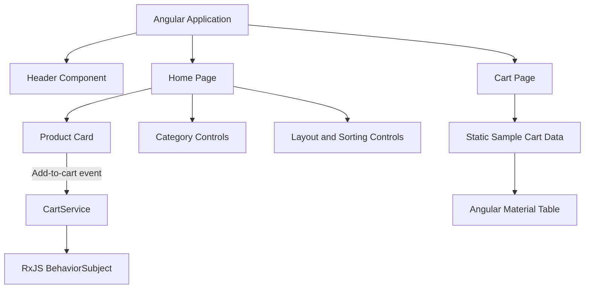

# Angular Storefront Prototype

A frontend e-commerce learning project built with **Angular 14, TypeScript, Angular Material, Tailwind CSS, and RxJS**.

The application explores component-based frontend development through a product catalog interface, shopping cart interactions, page navigation, and reactive state management.

> **Project status:** Early-stage Angular storefront prototype. This repository contains frontend code only. A Node.js backend, Stripe integration, and functional checkout are not implemented.

## Overview

The project demonstrates the structure of a simple e-commerce user interface.

It includes a home page with a sample product, layout controls, a category-selection interface, shopping cart interactions, and a separate cart page.

A dedicated Angular service uses an RxJS `BehaviorSubject` to maintain an in-memory cart state.

Some interface elements are currently placeholders, and the cart page uses static sample data rather than the state maintained by the cart service.

## Features

### Implemented

- Angular application with TypeScript
- Component-based product presentation
- Home and cart routes using Angular Router
- Angular Material user interface components
- Tailwind CSS utility classes
- Sample product card with image and price
- Add-to-cart event communication between components
- In-memory cart state using RxJS `BehaviorSubject`
- Quantity aggregation for repeated products in the cart service
- Snackbar feedback when adding a product
- Product grid layout selection
- Cart table with sample products
- Cart total calculation for displayed sample items

### UI Elements Not Yet Fully Connected

The frontend also includes:

- Category selection controls
- Product sorting controls
- Product count selection
- Cart quantity adjustment buttons
- Cart removal and clearing buttons
- Checkout button

These controls are visible in the interface but do not yet provide complete corresponding functionality.

## Technology Stack

| Technology | Purpose |
|---|---|
| Angular 14 | Frontend framework |
| TypeScript | Application logic and types |
| Angular Material | Interface components |
| Angular CDK | Angular UI utilities |
| Tailwind CSS 3 | Utility-based styling |
| RxJS | Reactive cart state |
| Angular Router | Client-side navigation |
| HTML and SCSS/CSS | Templates and styling |

Node.js and npm are used to install dependencies and run Angular development tooling.

There is no Node.js application server or Stripe integration in the current source code.

## Application Architecture



### Component Communication

The `ProductBoxComponent` emits an `addToCart` event.

The `HomeComponent` receives this event and calls `CartService.addToCart()`.

The cart service:

1. Reads the current in-memory cart items.
2. Checks whether the product already exists.
3. Increases the quantity if the product exists.
4. Otherwise, adds the new product.
5. Publishes the updated cart state.
6. Displays confirmation feedback through Angular Material Snackbar.

The cart page is not yet subscribed to this service and currently displays hard-coded sample items.

### Routing

Two application routes are implemented:

| Route | Component |
|---|---|
| `/home` | `HomeComponent` |
| `/cart` | `CartComponent` |

The root path redirects to `/home`.

## Project Structure

```text
Webshop_Angular_NodeJS_TypeScript_Stripe/
├── README.md
├── store/
│   ├── angular.json
│   ├── package.json
│   ├── package-lock.json
│   ├── src/
│   │   ├── app/
│   │   │   ├── components/
│   │   │   │   └── header/
│   │   │   ├── models/
│   │   │   │   ├── cart.model.ts
│   │   │   │   └── product.model.ts
│   │   │   ├── pages/
│   │   │   │   ├── home/
│   │   │   │   └── cart/
│   │   │   ├── services/
│   │   │   │   └── cart.service.ts
│   │   │   ├── app-routing.module.ts
│   │   │   └── app.module.ts
│   │   ├── environments/
│   │   └── styles.css
│   └── README.md
└── 01.png
```

### Important Files

- `app.module.ts` — Application module and Angular Material imports.
- `app-routing.module.ts` — Application navigation.
- `home.component.ts` — Home page layout and add-to-cart event handling.
- `product-box.component.ts` — Sample product presentation and cart event emission.
- `cart.component.ts` — Shopping cart table using example data.
- `cart.service.ts` — In-memory reactive cart state.
- `cart.model.ts` — Cart and cart-item interfaces.
- `product.model.ts` — Product interface.

## Getting Started

### Prerequisites

- Node.js and npm compatible with Angular CLI 14
- Git
- An internet connection for installing packages

The repository includes a `package-lock.json` file.

### 1. Clone the Repository

```bash
git clone https://github.com/waistarek/Webshop_Angular_NodeJS_TypeScript_Stripe.git

cd Webshop_Angular_NodeJS_TypeScript_Stripe/store
```

### 2. Install Dependencies

```bash
npm ci
```

The project uses older Angular and Angular Material dependency versions. Compatibility with current Node.js releases has not been verified.

### 3. Start the Development Server

```bash
npm start
```

Open the application at:

http://localhost:4200/

The default route redirects to `/home`.

### 4. Build the Application

```bash
npm run build
```

The Angular configuration specifies the output directory:

```text
store/dist/store/
```

The installation, build, and runtime have not been independently verified during this documentation review.

## Implementation Details

### Product Model

The application defines a TypeScript interface containing:

- Product ID
- Title
- Price
- Category
- Description field
- Image URL

The current product card uses one predefined example product with an externally hosted image.

### Shopping Cart State

The cart service initializes an empty cart:

```typescript
cart = new BehaviorSubject<Cart>({ items: [] });
```

The service supports adding items and increasing the quantity of an existing product.

The cart state is stored in memory only. It is not synchronized with the cart page or persisted to a database or browser storage.

### UI Components

The frontend uses several Angular Material components, including:

- Toolbar
- Sidenav and drawer
- Cards
- Grid lists
- Menus
- Tables
- Icons
- Buttons
- Snackbar notifications

Tailwind CSS provides additional layout and spacing utilities.

## Known Limitations

This repository is a frontend learning prototype, not a production-ready online store.

- No backend API or database.
- No Stripe integration or payment processing.
- No implemented checkout workflow.
- Only one predefined catalog product.
- Cart page uses static sample data.
- Header cart badge, contents, and totals are hard-coded.
- Category controls do not filter the product catalog.
- Sorting and item-count controls do not update the product list.
- Product quantity and removal buttons are not connected to cart operations.
- Cart state is not persisted across reloads.
- Product images depend on an external image URL.
- Angular and Angular Material package versions are from different major release lines.
- No automated test files are included in the archived repository.
- Successful installation and application execution have not been verified during this review.

## Learning Objectives

The project explores:

- Angular component architecture
- TypeScript interfaces and application models
- Angular routing
- Parent-child component communication
- Angular services and dependency injection
- Reactive state management using RxJS
- Angular Material UI development
- Tailwind CSS integration
- Basic e-commerce interface structure

## Project Scope

This project was created to practice Angular frontend development using an e-commerce interface.

It represents an early development stage and demonstrates selected frontend concepts rather than a complete shopping platform.
